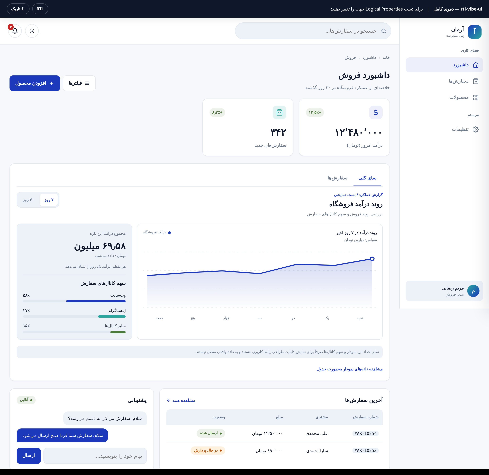
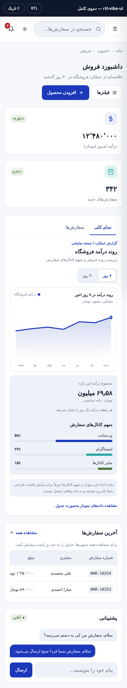

# RTL Vibe UI

**اسکیل جامع طراحی و کدنویسی UI راست‌به‌چپ برای ایجنت‌های هوش مصنوعی.**

[](LICENSE)
[](https://agentskills.io)
[](https://www.w3.org/TR/WCAG22/)

---

## این چیست؟

یک [Agent Skill](https://agentskills.io) است که به ایجنت‌های کدنویسی
(Claude Code، Cursor، GitHub Copilot، Gemini CLI و ۴۰+ میزبان دیگر)
یاد می‌دهد چگونه UI فارسی و عربی را **درست** بسازند — نه صرفاً
«فارسی‌سازی» شده.

برخلاف لیست‌های پراکنده قواعد RTL، این اسکیل:

- **لایه‌بندی‌شده** است: از قواعد بنیادی تا الگوهای کامپوننت.
- **مبتنی بر شواهد** است: WCAG 2.2، UAX #9، و مشخصات Agent Skills.
- **بومی** است: پالت رنگ بر پایه فلسفه ایرانی-اسلامی، نه ترجمه غربی.
- **عملیاتی** است: چک‌لیست PR، اسکریپت audit، و نمونه Tailwind v4.

## پیش‌نمایش واقعی دمو

تصاویر زیر مستقیماً با Playwright از `demo.html` نسخه `v1.0.1` در حالت **RTL / Light** ثبت شده‌اند. داده‌های فروش و سفارش‌ها نمایشی‌اند. برای مشاهده در اندازه کامل، روی تصویر کلیک کنید.

| دسکتاپ — عرض ۱۴۴۰ پیکسل | موبایل — عرض ۴۰۰ پیکسل |
|:---:|:---:|
| <a href="docs/images/demo-desktop.png"></a> | <a href="docs/images/demo-mobile.png"></a> |

## نصب

```bash
# با GitHub CLI (≥ 2.90.0)
gh skill install alinanakar-click2all/rtl-vibe-ui skills/rtl-vibe-ui

# یا با npx skills
npx skills add alinanakar-click2all/rtl-vibe-ui --skill rtl-vibe-ui
```

## مستندات و پیش‌نمایش

- [راهنمای اصلی اسکیل](skills/rtl-vibe-ui/SKILL.md)
- [دموی رسمی](demo.html) — داده‌های فروش نمایشی هستند.
- [راهنمای آزمون‌های مرورگری](browser-check/README-BROWSER-TESTS.md)
